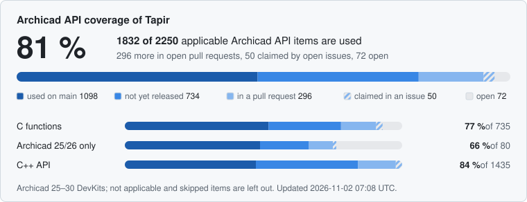
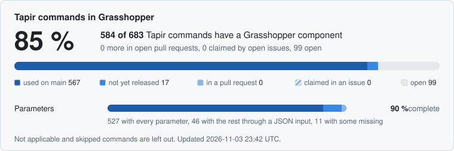

# Tapir: Archicad automation

[](https://discord.gg/NAnSennmpY)

Tapir adds hundreds of JSON commands to Graphisoft Archicad, on top of the official ones Graphisoft provides, so that the work you do by hand can be automated: reading and changing elements, properties, classifications, attributes, views, layouts, issues and more. You use them from Python scripts, from Grasshopper (Rhino) through the Tapir Grasshopper plugin, or without programming from the Tapir palette inside Archicad, which runs ready-made scripts with one click. Tapir is free and open source, made by ENZYME-APD and its community.

[](https://github.com/ENZYME-APD/tapir-archicad-automation/actions/workflows/archicad_addon_build_check.yml)
[](https://github.com/ENZYME-APD/tapir-archicad-automation/actions/workflows/grasshopper_plugin_build_check.yml)
[](https://github.com/ENZYME-APD/tapir-archicad-automation/actions/workflows/installer_build_check.yml)
[](https://archicad-api.com/api-coverage/)
[](https://archicad-api.com/gh-coverage/)

## Get started

### Install the Archicad Add-On

#### Easy installation (recommended)

Download and run the Tapir Installer. It detects the installed Archicad versions, downloads the matching Add-On version and installs it, so Archicad loads it automatically on the next start.

| Windows | macOS |
| --- | --- |
| [Download Installer](https://github.com/ENZYME-APD/tapir-archicad-automation/releases/latest/download/TapirInstaller_Win.exe) | [Download Installer](https://github.com/ENZYME-APD/tapir-archicad-automation/releases/latest/download/TapirInstaller_Mac.zip) |

Notes:
- **Windows:** the installer asks for administrator rights (it copies files into the Archicad folder under Program Files). It is code signed through SignPath (see the [Code signing policy](#code-signing-policy)) unless the notes of a release say that its installer is unsigned; for an unsigned installer Windows SmartScreen may warn about an unknown publisher: click "More info", then "Run anyway".
- **macOS:** unzip the downloaded file and open the app (it is signed and notarized).

#### Manual installation

Download the latest version here:

<!-- archicad-versions:start (written by tools/devkits.py update) -->
| Archicad version | Windows | macOS |
| --- | --- | --- |
| Archicad 25 | [Download](https://github.com/ENZYME-APD/tapir-archicad-automation/releases/latest/download/TapirAddOn_AC25_Win.apx) | [Download](https://github.com/ENZYME-APD/tapir-archicad-automation/releases/latest/download/TapirAddOn_AC25_Mac.zip) |
| Archicad 26 | [Download](https://github.com/ENZYME-APD/tapir-archicad-automation/releases/latest/download/TapirAddOn_AC26_Win.apx) | [Download](https://github.com/ENZYME-APD/tapir-archicad-automation/releases/latest/download/TapirAddOn_AC26_Mac.zip) |
| Archicad 27 | [Download](https://github.com/ENZYME-APD/tapir-archicad-automation/releases/latest/download/TapirAddOn_AC27_Win.apx) | [Download](https://github.com/ENZYME-APD/tapir-archicad-automation/releases/latest/download/TapirAddOn_AC27_Mac.zip) |
| Archicad 28 | [Download](https://github.com/ENZYME-APD/tapir-archicad-automation/releases/latest/download/TapirAddOn_AC28_Win.apx) | [Download](https://github.com/ENZYME-APD/tapir-archicad-automation/releases/latest/download/TapirAddOn_AC28_Mac.zip) |
| Archicad 29 | [Download](https://github.com/ENZYME-APD/tapir-archicad-automation/releases/latest/download/TapirAddOn_AC29_Win.apx) | [Download](https://github.com/ENZYME-APD/tapir-archicad-automation/releases/latest/download/TapirAddOn_AC29_Mac.zip) |
| Archicad 30 | [Download](https://github.com/ENZYME-APD/tapir-archicad-automation/releases/latest/download/TapirAddOn_AC30_Win.apx) | [Download](https://github.com/ENZYME-APD/tapir-archicad-automation/releases/latest/download/TapirAddOn_AC30_Mac.zip) |
<!-- archicad-versions:end -->

Once you downloaded the Add-On files you have to install it in Archicad. Follow these steps to install the Add-On.

1. Place the downloaded file somewhere on your computer.
2. In Archicad run the command "Options > Add-On Manager".
3. Open the "Edit List of Available Add-Ons" tabpage, and click on the "Add" button.
4. Browse the downloaded Add-On file.
5. Click "OK" in the Add-On Manager.

### Install the Grasshopper plugin

You can install the plugin from the Rhino Package Manager. The package is called "tapir".

### Run a command from Python

With Archicad and the Tapir Add-On running, this script asks the Add-On for its version. It needs nothing but Python. Archicad listens on port 19723; when several Archicads run, the others use the next ports (19724, 19725, ...).

```python
import json
import urllib.request

request = urllib.request.Request("http://127.0.0.1:19723", headers={"Content-Type": "application/json"})
body = {
    "command": "API.ExecuteAddOnCommand",
    "parameters": {
        "addOnCommandId": {"commandNamespace": "TapirCommand", "commandName": "GetAddOnVersion"},
        "addOnCommandParameters": {},
    },
}
with urllib.request.urlopen(request, json.dumps(body).encode()) as response:
    print(json.load(response)["result"]["addOnCommandResponse"])  # {'version': '...'}
```

Every Tapir command is called this way: change `commandName` and put the command's parameters in `addOnCommandParameters`. The [examples](archicad-addon/Examples/) use `aclib`, a small helper that does this for you.

#### Preview a change with `dryRun`

The commands that delete or change can be asked what they would do first. With `"dryRun": true` among its parameters such a command makes all the checks of a real run, with the same errors, but changes nothing in the project and adds no undo step; its response is a real run's plus `"dryRun": true`, and says for each target what would happen (`"wouldDelete": true` for an element `DeleteElements` would delete; for the bulk setters `SetPropertyValuesOfElements`, `SetClassificationsOfElements`, `SetCategoryValuesOfElements` and `SetGDLParametersOfElements`, `"wouldChange"` with the target's `oldValue` and the `newValue` a real run would write). Without `dryRun`, or with `false`, the command works as before. The [command reference](https://archicad-api.com/archicad-addon/) says which commands take it.

```python
preview = aclib.RunTapirCommand('DeleteElements', {'elements': elements, 'dryRun': True})
if all(result['success'] for result in preview['executionResults']):
    aclib.RunTapirCommand('DeleteElements', {'elements': elements})
```

### Use the Tapir palette in Archicad

The Add-On adds a **Tapir** menu to Archicad; open the palette with **Tapir > Tapir Palette**.

- The palette lists the scripts of [builtin-scripts/](builtin-scripts/), which it reads from this repository on GitHub when Archicad starts, the scripts of the GitHub repositories and folders named in its configuration file (`Documents/Tapir/config.json`), and the scripts you add with its *Add* button.
- Choose a script and run it. Python scripts run with [uv](https://docs.astral.sh/uv/), which takes care of Python and of the packages the script needs; if uv is missing, the palette offers to install it. The script is told the port of the Archicad it was started from, so it works on that Archicad, and its output is shown in the palette. A running script can be stopped.
- *Tapir > Manage Script Shortcuts...* puts up to six scripts on the menu commands *Tapir > Run Script Shortcut 1* to *6*, which you can give keyboard shortcuts in Archicad's Work Environment.

### Update the Add-On

- **From Archicad:** *Tapir > Check for Updates...*, or the *Check for Updates* button at the right end of the Tapir palette, next to the installed version. When a newer release exists for your Archicad version, the menu command reads *Update Tapir to &lt;version&gt;...* and the button *Update to &lt;version&gt;*; confirming downloads the Tapir Installer, which quits Archicad, replaces the Add-On and starts Archicad again.
- **Without that menu command or button:** older Tapir releases have neither. Download and run the [Tapir Installer](#easy-installation-recommended) with Archicad closed: it replaces the Add-On in every Archicad version you select. Later updates can then be made from Archicad.

## What you can do

- **[Command reference](https://archicad-api.com/archicad-addon/):** every Tapir command with its parameters, its response and a Python example from [archicad-addon/Examples](archicad-addon/Examples/).
- **The palette's built-in scripts**, in [builtin-scripts/](builtin-scripts/):
  - [AutomaticNumberingBasedOnPolyline](builtin-scripts/AutomaticNumberingBasedOnPolyline.py): sets the Element IDs of the selected elements in the order they follow along a selected polyline.
  - [BatchPublisher](builtin-scripts/BatchPublisher.py): publishes the chosen Publisher Sets in one go, now or on a schedule, optionally after receiving the Teamwork changes and updating the drawings on the layouts.
  - [ComplexElementFinder](builtin-scripts/ComplexElementFinder.py): finds the elements that make the project heavy (outlines with too many points, 3D models with too many polygons), selects them, and can reduce the points of polylines, fills and slabs.
  - [OrthoWallFinder](builtin-scripts/OrthoWallFinder.py): finds the walls that are not aligned to a 90° or 45° angle grid, highlights and selects them.
  - [ProjectHealthCheck](builtin-scripts/ProjectHealthCheck.py): runs quality checks on the model (elements without an Element ID, zones with the same number, unclassified or duplicate elements, unused stories and layers, ...); the findings can be selected, exported to Excel or CSV, or turned into Issues.
  - [PropertyHighlighter](builtin-scripts/PropertyHighlighter.py): colors the elements by the value of a chosen property, with a legend of the values.
  - [SolidOperationExplorer](builtin-scripts/SolidOperationExplorer.py): lists the solid element operations, highlights their targets and operators, and finds and removes the ones that no longer have an effect.
  - [UnusedViewCleaner](builtin-scripts/UnusedViewCleaner.py): finds the views of the View Map that are neither placed on a layout nor published, and moves the chosen ones into a separate folder.
- **[Your own palette scripts](builtin-scripts/README.md):** how to write a script for the palette, test it and share it in the [script marketplace](marketplace/README.md), with a [template](builtin-scripts/template/TEMPLATE.py) to start from.
- **[Workflows](archicad-addon/Workflows/):** Python scripts that combine several commands into a task, such as auditing library parts, syncing attributes between two Archicads or exporting the 3D model to OBJ.
- **[Grasshopper plugin](grasshopper-plugin/):** the commands as Grasshopper components, for visual scripting in Rhino. This is work in progress.
- **[Tapir GitHub wiki](https://github.com/ENZYME-APD/tapir-archicad-automation/wiki):** developer documentation.

## Ask for something

A job you do by hand in Archicad that Tapir could do for you, or something that does not work? [Open an issue](https://github.com/ENZYME-APD/tapir-archicad-automation/issues/new/choose), or write it in the bug report or feature request channels of the [Discord server](https://discord.gg/NAnSennmpY), from where it becomes an issue. Name the job and how you do it now. The project's issue bot answers it and, when it can, opens a pull request that does it.

The Add-On of every such pull request is built for every Archicad version, and a comment on the pull request links the downloads. Anyone can try it: load it through *Options > Add-On Manager* and say on the pull request whether it works for you. Testers can check pull requests on their own Archicad with the [community test runner](tools/community-test-runner/).

## Coverage

### Archicad API coverage

How much of the Archicad API the Tapir Add-On already uses. The image is updated automatically, within minutes of every change; the [full checklist](https://archicad-api.com/api-coverage/) lists every function. To ask for one, file an "Archicad API request" issue that names it.

<a href="https://archicad-api.com/api-coverage/">
  <picture>
    <source media="(prefers-color-scheme: dark)" srcset="https://raw.githubusercontent.com/ENZYME-APD/tapir-archicad-automation/api-coverage/api-coverage-dark.svg">
    
  </picture>
</a>

### Grasshopper coverage

How many of the Tapir Add-On's commands the Grasshopper plugin's components call, and whether they cover each command's parameters, updated the same way; the [full checklist](https://archicad-api.com/gh-coverage/) lists every command with its components and the parameters they miss.

<a href="https://archicad-api.com/gh-coverage/">
  <picture>
    <source media="(prefers-color-scheme: dark)" srcset="https://raw.githubusercontent.com/ENZYME-APD/tapir-archicad-automation/api-coverage/gh-coverage-dark.svg">
    
  </picture>
</a>

## Overview

The diagram below explains the components and their dependencies.


## Roadmap

[The Tapir Roadmap](https://github.com/orgs/ENZYME-APD/projects/4/views/1) is the older planning board; current work is in the [issues](https://github.com/ENZYME-APD/tapir-archicad-automation/issues) and [pull requests](https://github.com/ENZYME-APD/tapir-archicad-automation/pulls).

## Code signing policy

Free code signing provided by [SignPath.io](https://about.signpath.io), certificate by [SignPath Foundation](https://signpath.org).

This covers the Windows installer, `TapirInstaller_Win.exe`. It is built from this repository's sources by GitHub Actions on GitHub-hosted runners, and it is signed only after a manual approval. When a release cannot be signed, its Windows installer is released unsigned and its release notes say so. The Windows Add-On files (`.apx`) are not code signed. The macOS installer and macOS Add-Ons are signed and notarized with the project's own Apple Developer ID.

Team roles:
- Committers and reviewers: the maintainers with write access to this repository. Pull requests from people without write access, and the draft pull requests the project's automation opens from issues, are reviewed by a committer before they are merged; they are never merged automatically. Changes to the installer and to the build and release definitions are never merged automatically either, whoever proposes them.
- Approvers: [Tibor Lorántfy](https://github.com/tlorantfy)

### Privacy

The Tapir Installer contacts only GitHub:
- When its window opens, it asks `api.github.com` (or, if that fails, `github.com`) for the latest Tapir release.
- It downloads the Tapir Add-On from GitHub's release download servers when you click Install, or automatically when the Tapir Add-On's own update started it after you confirmed the update in Archicad.

These are plain HTTPS requests. Like any web request they show your IP address and the installer's name to GitHub, where the [GitHub General Privacy Statement](https://docs.github.com/en/site-policy/privacy-policies/github-general-privacy-statement) applies. The installer sends no personal data, has no telemetry and uploads nothing. During an update it also talks to the Archicad running on your own computer (127.0.0.1) to quit and restart it, which the Add-On announces before the update; this does not leave your computer. The installer writes only into the Add-Ons folders of the Archicad installations you select, or during an update next to the Tapir Add-On being updated, plus temporary files in your temp folder (an update lock file, `TapirUpdate_<port>.lock`, stays there). It can remove the Add-On again (Uninstall button, or `--uninstall`). Apart from this, this program will not transfer any information to other networked systems unless specifically requested by the user or the person installing or operating it.
