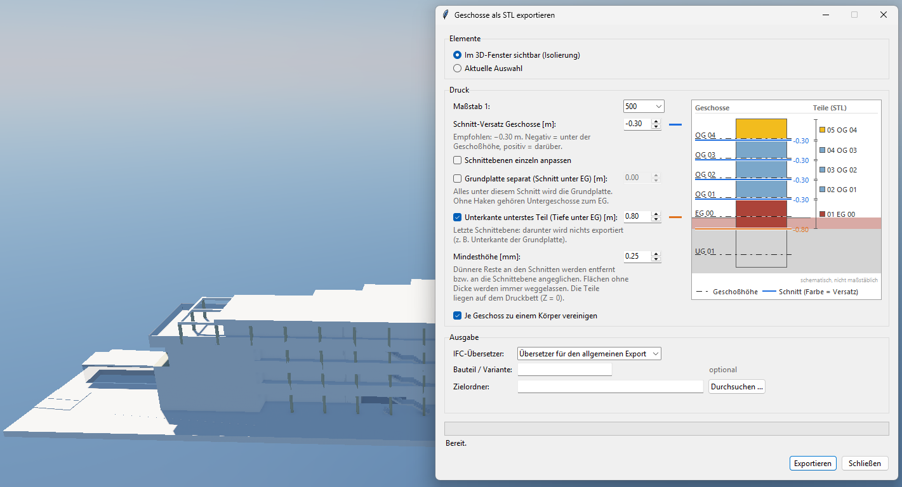
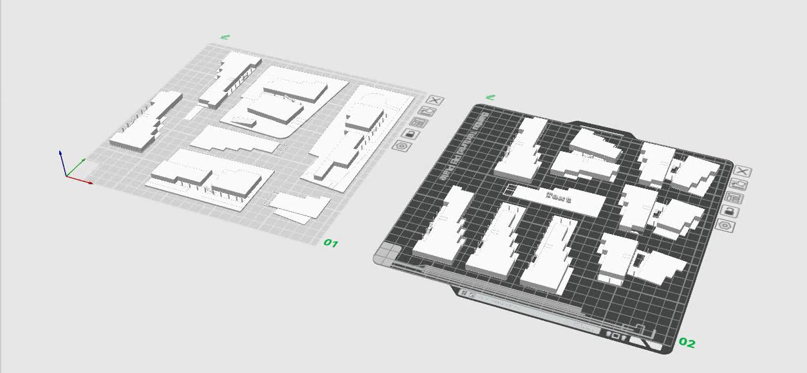

# Stories to STL for 3D printing

Exports what you see in the 3D window as one STL file per story, so you can
3D print a model that comes apart story by story. Each story is cut a little
below its level (default −0.30 m), the cut faces are closed, and every part
lies flat on the print bed at the print scale you choose.

*The window next to the isolated model. The section on the right shows the
stories, the cut planes (−0.30 m below each story, −0.80 m for the bottom) and
the five STL parts they make, coloured by height.*

*The exported parts in a slicer: each story lies flat on the bed, ready to
print. Stacked again, they make the model, and each story can be lifted off.*

## How to use it

1. Open the 3D window and show only what you want to print (isolate it, or
   select it).
2. Run the script from the Tapir palette. The first run takes a while: `uv`
   downloads IfcOpenShell, trimesh and manifold3d (a few hundred MB).
3. The window shows a schematic section of the stories the elements touch and
   the parts the STL files will be. It updates as you change the settings.
4. Choose the scale, the cut offset and the output folder, then press *Export*.
   If STL files from an earlier export with the same names are in that folder,
   the script asks before replacing them.

## Settings

| Setting | Default | What it does |
| --- | --- | --- |
| Elements | Visible in the 3D window | Or the current selection. |
| Scale 1: | 500 | The print scale. The STL files are in millimetres at this scale. |
| Cut offset from story level | −0.30 m | Where each story is cut, relative to its level. Negative = below the level, so the slab stays with the story above. |
| Set each cut plane individually | off | One row per story: switch a cut off (the story stays joined to the one below) or give it its own offset. |
| Separate base plate | off, 0.00 m | Cuts below the ground floor too; everything under that cut becomes its own part, *Base plate*. Off: basement stories belong to the ground-floor part. |
| Bottom of lowest part | on, 0.80 m below the ground floor | Nothing below this is exported (e.g. the underside of the base plate). |
| Minimum height | 0.25 mm | Slivers thinner than this in the print, at the cuts, are removed or snapped to the cut plane. |
| Union each story into one body | on | Merges all elements of a story into one closed body. |
| IFC translator | first in the list | The IFC export translator used for the temporary IFC file. |
| Part / variant | empty | Optional text added to the file names. |
| Output folder | `Documents/Tapir/STL/<project>_STL` | Where the STL files go. |

File names: `<project>_<part>_1-500_01_<story>.stl`, numbered from the bottom.

## What it changes

It changes nothing in the project. For the export it selects the elements,
saves them as a temporary IFC file and then restores your previous selection.
It writes:

- one STL file per part, in the output folder;
- a temporary IFC file in the system's temp folder, deleted when it is done.

## Limits

- Tried in Archicad 28. It needs the Tapir Add-On 1.6.0 or later, and the 3D
  window has to be the active window.
- Geometry comes through IFC: what your IFC translator leaves out does not
  appear in the STL. Openings, zones, annotations, grids and the site are
  never printed.
- Surfaces without thickness (e.g. some glass panes) are left out.
- The offsets and depths are in metres, whatever the units of the project.
- Large models take a few minutes; the window shows the progress.
- Windows and macOS. The window is in English.
- It can also be run without Archicad on an existing IFC file:
  `uv run --script stories_to_stl.py --ifc model.ifc --out stl_out --scale 500`

## Credits

Original by Constantin Koblmiller (`consier`). Published under the MIT licence.
